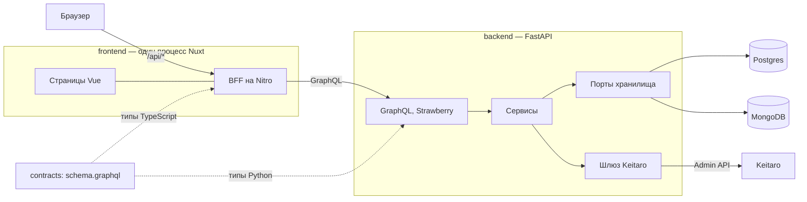
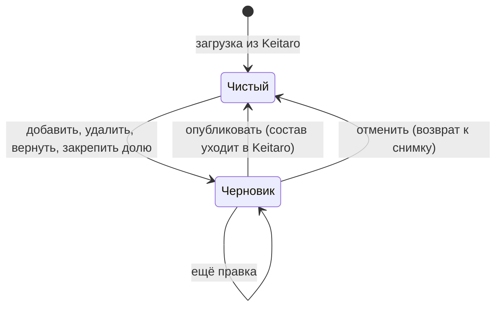
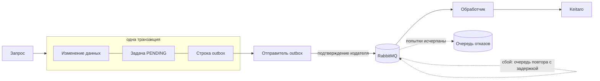

# Архитектура

Требования, на которые ссылается текст (`R-xx`), — в [SPEC.md](SPEC.md).

## Части



| Часть | Что делает | Чего не делает |
|-------|------------|----------------|
| `contracts/` | Хранит `schema.graphql` и генерирует из неё типы Python и TypeScript; собирается в npm-пакет и пакет Python с одной версией | Не содержит логики |
| `backend/` | Вся предметная логика: создание кампании, черновик потока, расчёт долей, сверка с Keitaro, хранение | Не знает об экранах |
| `frontend/` | Страницы и BFF: собирает данные экрана, проверяет форму ввода, приводит ошибки к `{ code, message, fields? }` | Не считает доли, не решает, что разрешено, не хранит состояние |

`backend/` и `frontend/` не импортируют код друг друга, обе зависят только от `contracts/`. Общий тип меняется в одном месте — `contracts/schema.graphql`; тест бэкенда сравнивает его схему со схемой пакета, CI проверяет, что повторная генерация ничего не меняет.

Браузер обращается только к `/api/*` своего сервера. Адрес бэкенда и ключ Keitaro в браузер не попадают, порт бэкенда наружу не открыт.

## Слои бэкенда

```
app/
  graphql/     резолверы поверх типов контракта; отказ — член union, а не исключение
  services/    creator, editor, catalog, shares (чистая функция), модели и ошибки предметной области
  keitaro/     типизированный клиент Admin API и протокол шлюза для подмены в тестах
  storage/     порты; адаптеры sqlalchemy, mongo, memory; фабрика по STORAGE_BACKEND
  messaging/   порт шины; реализации memory и rabbitmq; отправитель outbox
```

Зависимости идут в одну сторону: `graphql → services → storage.ports | keitaro.gateway`. Резолвер вызывает один метод сервиса. Сервис не знает, какая база под портом: три адаптера проходят один набор контрактных тестов (`backend/tests/storage/`).

## Модель редактора

Поток хранится у нас целиком: офферы с текущими значениями (черновик) и снимком того, что лежит в Keitaro (`published`). Признак «не опубликовано» вычисляется сравнением и не хранится.



- Удалённый оффер остаётся в потоке со статусом `removed` и долей 0 — его можно вернуть.
- После каждой правки доли пересчитываются: закреплённые сохраняются, остаток делится поровну между остальными, сумма всегда 100. Невозможное распределение — отказ, поток не меняется.
- Загрузка из Keitaro при неопубликованном черновике отклоняется, чтобы не потерять правки.

## Конкурентная запись

- У потока есть номер записи `version`. Запись условная: `UPDATE … WHERE id = :id AND version = :v` в Postgres, `replace_one({_id, version})` в MongoDB. Проигравший запрос получает отказ «конфликт» с актуальным потоком и ничего не меняет (R-CC-01…03).
- Версия уходит в браузер и возвращается с каждым действием: правка из устаревшего окна отклоняется, окно показывает актуальное состояние (R-CC-06).
- Всё, что сервис пишет за одно действие, — одна транзакция (`Storage.transaction()`): поток, его офферы и запись журнала применяются вместе или не применяются (R-ST-06).
- Идентификаторы кампаний и потоков выводятся из идентификаторов Keitaro (`uuid5`), поэтому две одновременные загрузки одной кампании сходятся к одной записи (R-CC-04).

## Задачи, outbox и шина

Так выполняются обе записи в Keitaro: публикация потока и создание кампании.



- **Задача** — запись об изменении в Keitaro, которое выполняется отдельно от запроса. ID выдаёт клиент, он же ключ идемпотентности: вторая задача с тем же ID отклоняется первичным ключом (R-TK-03). Переход между статусами условный — из двух одновременных переходов проходит один (R-TK-02).
  Общее для всех задач — повтор ключа, взятие задачи в работу, различие временного сбоя и отказа — лежит в `backend/app/services/attempts.py`; сообщение отдаётся сервису по таблице «тема → сервис», тема без владельца пишется в журнал как ошибка.
- **Outbox** — сообщение пишется в ту же транзакцию, что и изменение данных, поэтому не может ни потеряться, ни уйти без изменения (R-EV-01). Отправитель берёт сообщения в аренду (`FOR UPDATE SKIP LOCKED` в Postgres, `find_one_and_update` в MongoDB): два отправителя не берут одно сообщение, брошенное возвращается после срока аренды (R-EV-02).
- **Шина** — порт `MessageBus` с двумя реализациями, выбор переменной `MESSAGE_BUS`. В RabbitMQ очереди и сообщения устойчивые, публикация с подтверждением, обработка подтверждается после работы обработчика. Доставка «не меньше одного раза» (R-EV-03…06).

### Публикация потока

1. `publishStream` проверяет поток (версия, занятость, есть активные офферы) и одной транзакцией пишет задачу `PENDING`, отметку `publishing` на потоке и сообщение `stream.publish.requested`. Ответ — задача; в Keitaro запрос не ходит.
2. Пока задача не завершена, поток занят: правки, отмена, повторная публикация и загрузка из Keitaro получают отказ `StreamBusy` (R-ED-25).
3. Обработчик берёт задачу условным переходом в `RUNNING`, заменяет состав потока в Keitaro (замена целиком идемпотентна — повтор безопасен) и одной транзакцией пишет итог: снимок опубликованного, снятую отметку, журнал «до/после», задачу `SUCCEEDED` и событие `stream.published`.
4. Сбой сети и 5xx — сообщение доставляется снова с задержкой; 4xx, исчерпание попыток и сообщение из очереди отказов завершают задачу `REJECTED` с причиной, черновик остаётся (R-EV-08).
5. Повтор запроса с тем же `taskId` возвращает ту же задачу; интерфейс создаёт `taskId` сам и опрашивает `task(id)` до конечного статуса (R-TK-04, R-UX-18).

Процессы: с `MESSAGE_BUS=memory` отправитель и обработчик работают внутри веб-процесса; с `rabbitmq` — отдельно: `python -m app.relay` и `python -m app.worker` (`backend/app/runtime.py` собирает все три).

Готовность: `GET /health/ready` бэкенда опрашивает хранилище, шину и кэш с ограничением по времени и отвечает 503 с названиями неответивших частей; `GET /health` говорит только, что процесс жив. Отправитель и обработчик завершаются по SIGTERM.

### Создание кампании

Шаги не идемпотентны, поэтому задача — сага с отметками (`backend/app/services/creator.py`).

1. `createCampaign` проверяет форму и одной транзакцией пишет задачу и сообщение `campaign.create.requested`. В задаче — проверенный запрос и заранее выбранный alias кампании. Замечания по полям возвращаются сразу, без задачи.
2. Обработчик идёт по шагам: домен → кампания → поток 1 → поток 2. После домена и кампании он записывает отметку в задачу.
3. Повторная доставка продолжает с несделанного. Если ответ Keitaro потерялся и отметки нет, сделанное находится в самом трекере: домен — по имени, кампания — по alias, потоки — по позиции в кампании. Дублей не возникает.
4. Сеть и 5xx — новая попытка. 4xx, исчерпание попыток и очередь отказов — компенсация: кампания удаляется (в том числе найденная по alias), созданный домен остаётся, задача `REJECTED` с причиной.
5. Успех одной транзакцией пишет кампанию, потоки, журнал, задачу с `campaignId` и событие `campaign.created`.

Ограничение: два обработчика, взявшие одну задачу одновременно, не разводятся блокировкой — шина отдаёт сообщение повторно только после отказа или гибели обработчика.

### Управление задачами

Страница `/tasks` читает одним запросом сводку (`queueStatus`: задачи по статусам, неотправленные сообщения outbox, очереди шины и число их обработчиков) и последние задачи. Ожидающую задачу можно отменить — условным переходом `PENDING → CANCELLED` с освобождением потока в той же транзакции; отклонённую задачу — повторить новой со ссылкой `retryOf`: публикация берёт текущий черновик, создание кампании — сохранённый в задаче запрос, который проверяется заново. Сервис — `backend/app/services/tasks.py`.

## Кэш справочников

Домены, группы, источники и активные офферы читаются через порт `Cache` (`backend/app/cache/`), выбор — переменной `CACHE_BACKEND`. Значение — JSON со сроком жизни `CATALOG_TTL`.

- **Память** — словарь и замок на ключ; у каждого процесса свой.
- **Redis** — общий для всех процессов. При промахе читатель ставит замок `SET NX PX`; взявший замок читает Keitaro и кладёт значение, остальные ждут значение. Замок снимается только владельцем и истекает сам, если владелец пропал.

Недоступный кэш обходится: справочник читается из Keitaro напрямую. Проверка формы создания кэш не использует. После создания домена список доменов сбрасывается.

## Интерфейс

Nuxt 4, Vue 3, TypeScript. Компонент знает только `/api/*`; запросы GraphQL и их типы живут в `frontend/server/graphql/` и генерируются из контракта. Цвета, шрифты и отступы — токены из `frontend/DESIGN.md`, светлая и тёмная темы. Состояние не передаётся одним цветом: у «не опубликовано», «удалён» и «закреплено» есть текст или значок.

## Проверка

| Уровень | Где | Что проверяет |
|---------|-----|---------------|
| Расчёт долей | `backend/tests/services/test_shares.py` | таблица случаев и property-тесты |
| Сервисы | `backend/tests/services/` | сценарии S1–S8 на поддельном трекере в памяти |
| Хранилище | `backend/tests/storage/` | один контракт на Postgres, MongoDB и памяти; гонки записи |
| Шина | `backend/tests/messaging/` | один контракт на памяти и настоящем RabbitMQ |
| GraphQL | `backend/tests/graphql/` | резолверы, совпадение схемы с контрактом, ограничения запроса |
| BFF | `frontend/tests/server/` | маршруты с подменой GraphQL |
| Компоненты | `frontend/tests/app/` | состояния интерфейса |
| Сквозные | `frontend/tests/e2e/` | весь сервис в браузере, Keitaro заменён поддельным трекером по HTTP |

Тесты не обращаются к настоящему Keitaro. Каждое требование ТЗ привязано к тесту в матрице SPEC.md (раздел 11).
